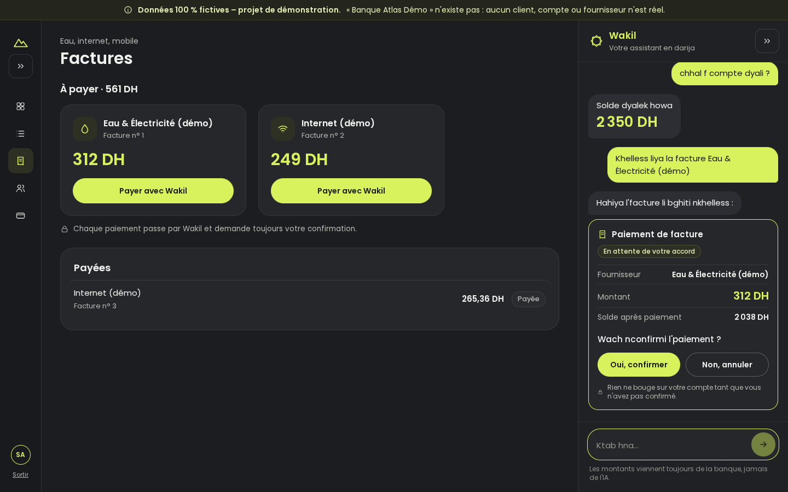
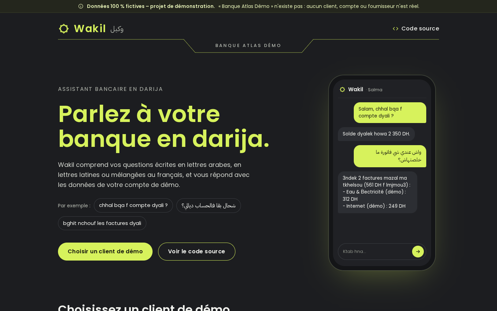
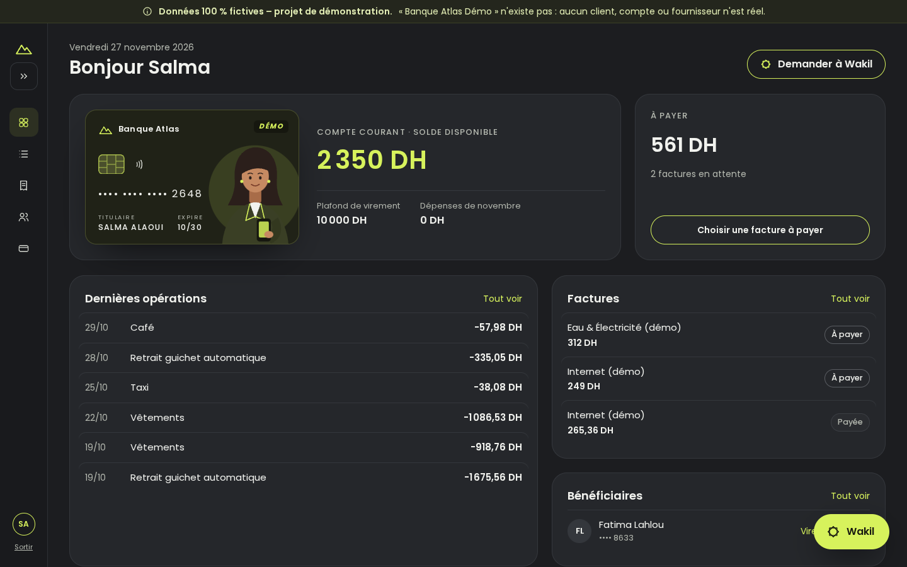
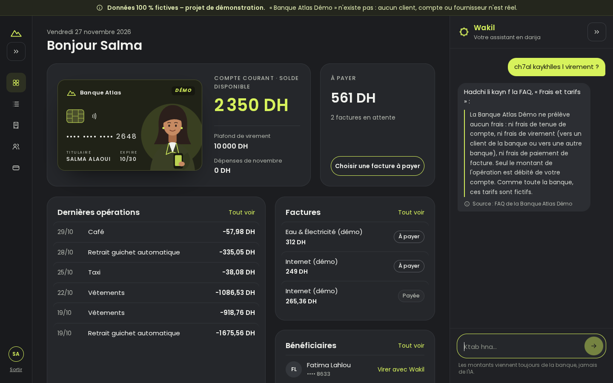
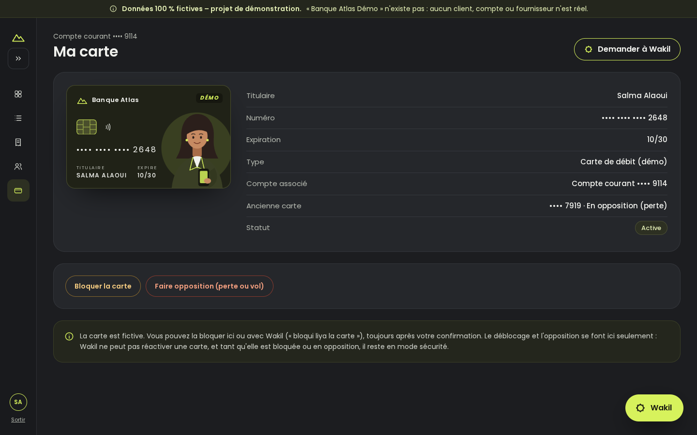
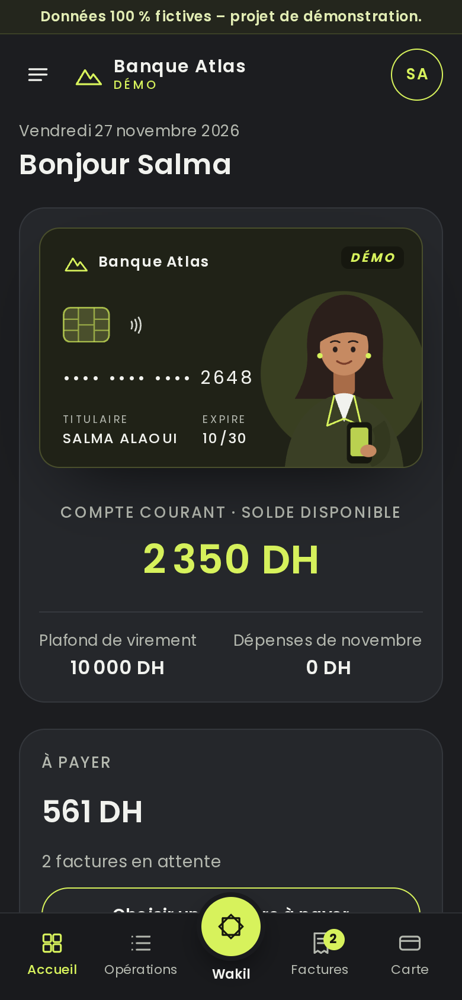
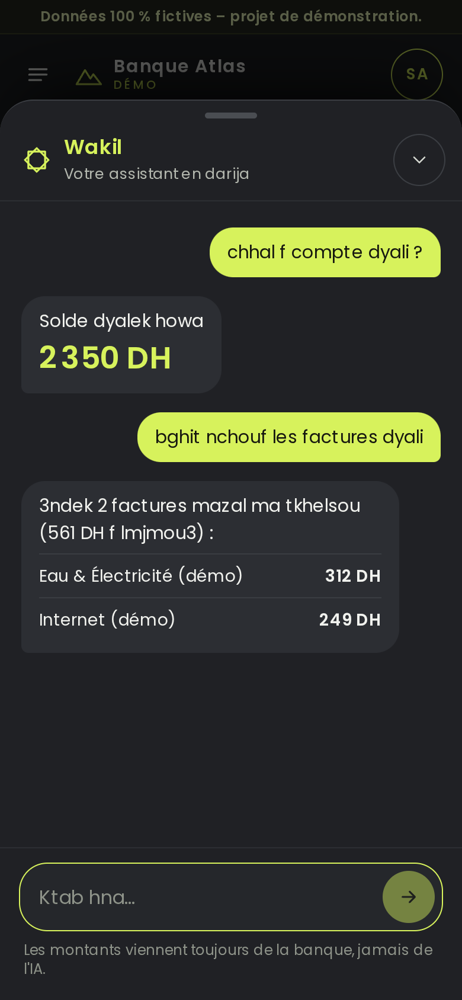
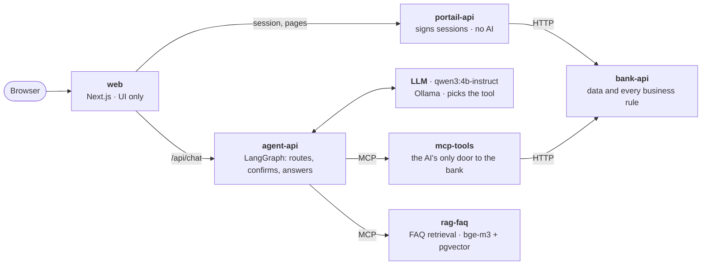

# Wakil — a Darija banking agent, evaluated and secured

[](https://github.com/Oumaima-Lg/wakil/actions/workflows/ci.yml)
[](https://github.com/Oumaima-Lg/wakil/actions/workflows/benchmark.yml)

> **100% fictional data — demo project** (*Données 100 % fictives – projet de démonstration*). "Banque Atlas Démo" does not exist; no customer, account or supplier is real.

**Wakil** (وكيل, "agent") is a banking assistant that **understands Moroccan Darija** — written in Arabic script, in Latin script (Arabizi) or mixed with French — and **acts** on the customer's account: balance, statements, spending, bills, transfers, card blocking. Nothing that moves money happens without an explicit **"Oui"**.

It comes with an **open benchmark** that measures whether a model understands a Darija banking request and calls the right tool with the right parameters. Darija language models exist; to our knowledge, no public evaluation measured whether they can *act*.



## Highlights

| | |
|---|---|
| **Darija benchmark** | 113 unseen requests (Darija in three scripts, French, English, Modern Standard Arabic), scored by a deterministic judge. `qwen3:4b-instruct` 78 %, Darija specialist `atlas-chat:9b` 81 %: no significant gap (McNemar p ≥ 0.11). [Details](docs/benchmark.md) |
| **Security** | 32 attacks mapped to the OWASP Top 10 for LLM Applications 2025 and for Agentic Applications 2026. Success rate **17 % → 0 %** after signed service-to-service tokens and rate limiting — with the limits of that number spelled out. [Report](docs/securite.md) |
| **Local models only** | Ollama runs the LLM (`qwen3:4b-instruct`, native tool calling) and the embeddings (`bge-m3`): no customer data leaves the machine. [Decision record](docs/adr/0003-choix-des-modeles.md) |
| **CI as a gate** | Every pull request runs the tests and architecture contracts of the five Python services, the web build, a secret scan, a Trivy scan of the six images (with their SBOM) and of the Terraform code, and a **blocking benchmark** (≥ 75 %; 79.6 % on a CPU runner). |

## Demo

The UI is in French and Darija. These screenshots are taken by a [script](docs/captures/capturer.py) that drives a headless browser through the app.

| | |
|---|---|
|  |  |
| **Choose a demo customer** — three fictional profiles | **The banking space** — card, balance, bills, transactions, payees |
|  |  |
| **FAQ answers are quoted, never generated** — retrieved with `bge-m3` + pgvector | **Card management** — Wakil may only *block* a card; unblocking stays in the app |

<p align="center">
  
  &nbsp;&nbsp;
  
</p>

```text
Client : Salam, chhal bqa f compte dyali ?
Wakil  : Solde dyalek howa 2 350 DH.
Client : Mzyan, khelless liya la facture dyal l'eau.
Wakil  : Facture Eau & Électricité (démo) : 312 DH. Wach nconfirmi l'paiement ? (Oui / Non)
Client : Oui
Wakil  : Tkhelssat ✅
```

## How it works



- **The LLM chooses, the code decides.** The model only picks a tool from a closed list. The bank enforces every rule (balance, limits, unpaid bill, known payee), and the code writes every answer: every amount shown comes from the bank, and the model cannot leak its prompt.
- **A human confirms every operation.** A LangGraph `interrupt()` pauses before any payment, transfer or card block, after a dry run at the bank. Only an explicit "Oui", read by the code, executes it.
- **The AI reaches the bank only through MCP**, with short-lived signed tokens between services: the agent itself holds no private key ([ADR 0004](docs/adr/0004-jetons-entre-services.md)).
- **No lethal trifecta.** No tool can send data outside, and the LLM never re-reads account data, so a poisoned transaction label never reaches it.
- **Separate databases and users** for the bank, the agent's conversations and the FAQ, and architecture contracts (import-linter) checked in CI: the agent cannot import an HTTP client, the portal cannot import any AI library.

Service by service, with the reasons behind the split: [architecture](docs/architecture.md) and [ADR 0001](docs/adr/0001-roles-des-services.md).

## Run it locally

Requirements: [Docker](https://docs.docker.com/get-docker/), [uv](https://docs.astral.sh/uv/), Node.js 24 and [Ollama](https://ollama.com) (about 4 GB of models).

```bash
cp .env.example .env                                     # then replace every "a-remplacer" with a random value
(cd apps/portail-api && uv run python -m app.cles >> ../../.env)   # session keys (RS256)
(cd apps/mcp-tools && uv run python -m app.jetons >> ../../.env)   # service-token keys
ollama pull qwen3:4b-instruct && ollama pull bge-m3
docker compose up -d --wait                              # PostgreSQL + pgvector
uv run --env-file .env data/seed/generer_donnees.py      # fictional bank data
(cd apps/rag-faq && uv run --env-file ../../.env python -m app.faq)  # FAQ index
docker compose --profile images up -d --build            # the six services → http://localhost:3100
```

Development mode (hot reload with `uvx honcho start`), tests, benchmark, attacks and CI: see the [development guide](docs/developpement.md).

## Documentation

The detailed documents are written in French.

| Topic | Document |
|---|---|
| Architecture, the six services, the FAQ, cards and security mode | [docs/architecture.md](docs/architecture.md) |
| Darija benchmark: method, results by model, language and author, lessons | [docs/benchmark.md](docs/benchmark.md) · [full results](evals/benchmark/resultats.md) |
| Security report: attacks, protections layer by layer, limits | [docs/securite.md](docs/securite.md) · [attack results](evals/securite/resultats.md) |
| Development: setup, tests, measurements, screenshots, CI | [docs/developpement.md](docs/developpement.md) |
| Decision records: service roles, quoted FAQ, model choice, service tokens, Azure deployment | [docs/adr/](docs/adr/) |

## Tech stack

| Layer | Tools |
|---|---|
| Front-end | Next.js 16, React 19, TypeScript, Tailwind CSS |
| Back-end | Python 3.14, FastAPI, PostgreSQL |
| AI | LangGraph, LangChain, MCP (Python SDK), Ollama, pgvector |
| Evaluation & security | promptfoo, custom deterministic judges, OWASP LLM and Agentic Top 10 |
| Delivery | Docker (multi-stage, non-root images), GitHub Actions, gitleaks, Trivy + CycloneDX SBOM, Dependabot |
| Infrastructure as code | Terraform (azurerm 5): Azure Container Apps, Container Registry, Key Vault, PostgreSQL Flexible — written and checked in CI, not yet deployed |

## Status

- [x] Fictional bank, LangGraph agent and Next.js banking app (desktop and mobile)
- [x] Human confirmation, MCP servers, FAQ retrieval with quoted answers
- [x] Darija benchmark: 5 local models compared, v1 models chosen
- [x] Security: 32 attacks, protections measured one by one, CI with a blocking benchmark
- [ ] Cloud deployment: production images and Terraform code done (no secret ever stored in Terraform state); deployment to Azure to come
- [ ] Observability (OpenTelemetry), version 1.0

## Author

Oumaima Laghjibi — Software engineer · [LinkedIn](https://www.linkedin.com/in/oumaima-laghjibi-745786287) · [GitHub](https://github.com/Oumaima-Lg)
