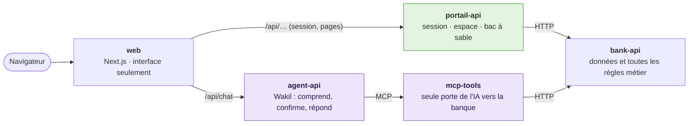

# Wakil — agent bancaire en darija, évalué et sécurisé

> **Données 100 % fictives – projet de démonstration.** « Banque Atlas Démo » n'existe pas ; aucun client, compte ou fournisseur n'est réel.

**Wakil** (وكيل, « agent ») est un assistant bancaire qui **comprend la darija** (écriture arabe, lettres latines ou mélange avec le français) et **agit** : consulter un solde, payer une facture, faire un virement. Il demande toujours une **confirmation** avant une opération.

Le projet publie aussi un **benchmark ouvert** : il mesure si les modèles d'IA comprennent une demande en darija et appellent le bon outil avec les bons paramètres. À notre connaissance, aucune évaluation publique de ce type n'existe pour la darija.

```text
Client : Salam, chhal bqa f compte dyali ?
Wakil  : Solde dyalek howa 2 350 DH.
Client : Mzyan, khelless liya la facture dyal l'eau.
Wakil  : Facture Eau & Électricité (démo) : 312 DH. Wach nconfirmi l'paiement ? (Oui / Non)
Client : Oui
Wakil  : Tkhelssat ✅
```

## Architecture



En vert, les pages et le bac à sable, sans IA. En violet, le chemin de l'IA.

| Service | Port | Son rôle | Ce qu'il ne fait jamais |
|---|---|---|---|
| `web` (Next.js) | 3000 | Les pages et le chat. Envoie `/api/chat` à agent-api et le reste de `/api/…` à portail-api | Aucune règle métier, aucun appel à bank-api |
| `portail-api` (FastAPI) | 8003 | Ouvre la session (jeton signé avec la clé privée, dans un cookie HttpOnly) et sert les pages de l'espace bancaire ; plus tard, le bac à sable des visiteurs | Aucune IA : ni LLM, ni agent, ni outil MCP |
| `agent-api` (FastAPI, LangGraph) | 8001 | Wakil : le LLM comprend la demande et choisit l'outil ; le code demande « Wach nconfirmi ? » avant toute opération et écrit la réponse | Ne crée aucune session (il n'a que la clé publique), n'appelle jamais bank-api directement |
| `mcp-tools` (serveur MCP) | 8002 | Les outils de la banque pour l'IA : retrouve la facture ou le bénéficiaire ; sans la confirmation du client, fait seulement une vérification à blanc | Ne prend jamais le client dans les arguments du LLM (il vient de l'en-tête de la requête) |
| `bank-api` (FastAPI, PostgreSQL) | 8000 | Les données fictives et toutes les règles : solde suffisant, plafond, facture déjà payée, compte du bon client ; journal d'audit | Ne connaît ni l'IA, ni le navigateur |

Trois règles tiennent cette découpe :

- **Un seul chemin de l'IA vers la banque** : agent-api → mcp-tools → bank-api. Des contrats [import-linter](https://import-linter.readthedocs.io/) (l'équivalent Python d'ArchUnit) le vérifient à chaque `uv run lint-imports` :
  - agent-api ne peut importer aucun client HTTP ;
  - portail-api ne peut importer aucune brique d'IA.
- **La session est créée à un seul endroit** : portail-api signe le jeton (RS256) avec sa clé privée. agent-api le vérifie avec la clé publique, sans pouvoir en fabriquer.
- **Les règles métier ne sont jamais confiées au LLM** : c'est bank-api qui accepte ou refuse une opération.

Les conversations de l'agent sont dans une base PostgreSQL séparée (`wakil_agent`). Elle a son propre utilisateur, sans aucun droit sur la base de la banque. Le LLM tourne en local avec Ollama. Le pourquoi de cette découpe est expliqué dans [docs/adr/0001-roles-des-services.md](docs/adr/0001-roles-des-services.md).

À venir :

- RAG sur la FAQ (pgvector) dans agent-api ;
- traces OpenTelemetry vers Phoenix ;
- déploiement sur Azure (Terraform, Ansible, Vault, GitHub Actions).

## Stack

| Couche | Outils |
|---|---|
| Front-end | Next.js, TypeScript |
| Back-end | Python, FastAPI |
| IA | LangGraph, LangChain, MCP, Ollama, pgvector |
| Évaluation et sécurité | promptfoo, DeepEval, OWASP Top 10 LLM et agentique |
| Données | PostgreSQL, Faker |
| CI/CD | GitHub Actions, gitleaks, Trivy, Checkov |
| Infrastructure | Terraform, Ansible, HashiCorp Vault, Azure Key Vault |
| Cloud | Azure Container Apps, ACR, PostgreSQL Flexible Server |
| Observabilité | OpenTelemetry, Phoenix |

## Lancer en local

Prérequis : [Docker](https://docs.docker.com/get-docker/), [uv](https://docs.astral.sh/uv/) (Python), Node.js 24 et [Ollama](https://ollama.com).

```bash
# 1. Les secrets : copier le modèle, puis remplacer chaque « a-remplacer » par une valeur tirée au hasard,
#    par exemple : python3 -c "import secrets; print(secrets.token_urlsafe(32))"
cp .env.example .env

# 2. Les clés des jetons de session (RS256), ajoutées à la fin de .env (jamais commitées)
(cd apps/portail-api && uv run python -m app.cles >> ../../.env)

# 3. Le modèle de langue (environ 2,5 Go), la base de données, les données fictives et les paquets du site
ollama pull qwen3:4b-instruct
docker compose up -d --wait
uv run --env-file .env data/seed/generer_donnees.py
(cd apps/web && npm ci)
```

Puis lancer les cinq services d'une seule commande. [honcho](https://honcho.readthedocs.io/) lit le fichier `Procfile` (une ligne par service), affiche les journaux de chacun avec un préfixe de couleur, et Ctrl+C arrête tout :

```bash
uvx honcho start
```

Pour lancer un seul service, par exemple pour le redémarrer à part, copier sa ligne du `Procfile` dans un terminal.

Sur http://localhost:3000, choisir un client de démo, ouvrir l'espace bancaire, puis Wakil. Après quelques minutes sans message, Ollama décharge le modèle : la réponse suivante peut prendre jusqu'à 30 secondes.

Les tests, et les contrats d'architecture (`lint-imports`) :

```bash
cd apps/bank-api && uv run --env-file ../../.env pytest      # base démarrée et remplie
cd apps/mcp-tools && uv run pytest && uv run lint-imports    # le test lance son serveur MCP ; banque simulée
cd apps/portail-api && uv run pytest && uv run lint-imports  # banque simulée, paire de clés de test
cd apps/agent-api && uv run pytest && uv run lint-imports    # sans Ollama ni serveur MCP (doublures)
cd apps/web && npm run lint && npm run typecheck
```

## Ce que le projet mesure

- Taux de bons outils choisis et de paramètres exacts, par modèle et par écriture (arabe, latin, mélange)
- Respect de la confirmation avant chaque opération
- Taux de réussite des attaques (injection de prompt, accès au compte d'un autre client…), avant et après les protections
- Temps de réponse et coût par conversation

## Avancement

- [x] S0 — Premiers appels d'outils avec Ollama
- [x] S1 — Banque fictive (API + fausses données)
- [x] S2 — Agent LangGraph + interface Next.js (espace bancaire, chat en direct, version mobile)
- [ ] S3 — Confirmation, serveur MCP, RAG sur la FAQ
- [ ] S4 — Benchmark darija
- [ ] S5 — Sécurité + CI avec évaluation bloquante
- [ ] S6 — Déploiement Azure avec Terraform
- [ ] S7 — Ansible, Vault, observabilité, budget
- [ ] S8 — Documentation, vidéo, version 1.0

## Auteure

Oumaima Laghjibi — Ingénieure logicielle · [LinkedIn](https://www.linkedin.com/in/oumaima-laghjibi-745786287) · [GitHub](https://github.com/Oumaima-Lg)

---

**English summary.** Wakil is a Darija-speaking banking agent built on a fully fictional bank. It understands Moroccan Arabic written in Arabic script, Latin script (Arabizi) or mixed with French, calls banking tools through MCP, and always asks for confirmation before any operation. The project publishes an open benchmark of LLM tool-calling accuracy in Darija, a security report on prompt-injection resistance, and is deployed on Azure with Terraform, Ansible, Vault and GitHub Actions.
