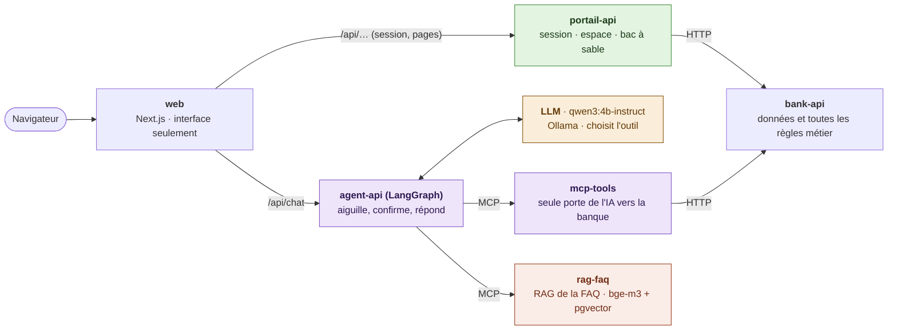

# Wakil — agent bancaire en darija, évalué et sécurisé

> **Données 100 % fictives – projet de démonstration.** « Banque Atlas Démo » n'existe pas ; aucun client, compte ou fournisseur n'est réel.

**Wakil** (وكيل, « agent ») est un assistant bancaire qui **comprend la darija** (écriture arabe, lettres latines ou mélange avec le français) et **agit** : consulter un solde, payer une facture, faire un virement. Il demande toujours une **confirmation** avant une opération.

Le projet publie aussi un **benchmark ouvert** : il mesure si les modèles d'IA comprennent une demande en darija et appellent le bon outil avec les bons paramètres. À notre connaissance, aucune évaluation publique de ce type n'existe pour la darija.

```text
Client : Salam, chhal bqa f compte dyali ?
Wakil  : Solde dyalek howa 2 350 DH.
Client : Mzyan, khelless liya la facture dyal l'eau.
Wakil  : Facture Eau & Électricité (démo) : 312 DH. Wach nconfirmi l'paiement ? (Oui / Non)
Client : Oui
Wakil  : Tkhelssat ✅
```

## Architecture



En vert, les pages et le bac à sable, sans IA. En violet, le chemin de l'IA. En jaune, le LLM, qui **décide** quel outil appeler. En orange, le RAG de la FAQ, qui **cherche**.

| Service | Port | Son rôle | Ce qu'il ne fait jamais |
|---|---|---|---|
| `web` (Next.js) | 3000 | Les pages et le chat. Envoie `/api/chat` à agent-api et le reste de `/api/…` à portail-api | Aucune règle métier, aucun appel à bank-api |
| `portail-api` (FastAPI) | 8003 | Ouvre la session (jeton signé avec la clé privée, dans un cookie HttpOnly) et sert les pages de l'espace bancaire ; plus tard, le bac à sable des visiteurs | Aucune IA : ni LLM, ni agent, ni outil MCP |
| `agent-api` (FastAPI, LangGraph) | 8001 | Wakil : le LLM comprend la demande et choisit l'outil ; LangGraph aiguille vers les outils de la banque ou la FAQ, demande « Wach nconfirmi ? » avant toute opération, et le code écrit la réponse | Ne crée aucune session (il n'a que la clé publique), n'appelle jamais bank-api directement, n'a aucun accès à l'index de la FAQ |
| `mcp-tools` (serveur MCP) | 8002 | Les outils de la banque pour l'IA : retrouve la facture ou le bénéficiaire ; sans la confirmation du client, fait seulement une vérification à blanc | Ne prend jamais le client dans les arguments du LLM (il vient de l'en-tête de la requête) |
| `rag-faq` (serveur MCP) | 8004 | Le RAG de la FAQ : l'outil `question_faq` retrouve la fiche la plus proche (bge-m3 + pgvector, dans sa propre base) ; l'indexation de `faq.yaml` | Ne rédige rien, ne parle ni à la banque ni au LLM de l'agent, ne reçoit pas l'identité du client |
| `bank-api` (FastAPI, PostgreSQL) | 8000 | Les données fictives et toutes les règles : solde suffisant, plafond, facture déjà payée, compte du bon client ; journal d'audit | Ne connaît ni l'IA, ni le navigateur |

Trois règles tiennent cette découpe :

- **L'IA n'atteint la banque et la FAQ que par MCP** : agent-api → mcp-tools → bank-api, et agent-api → rag-faq. Chaque outil n'est accepté que de son serveur. Des contrats [import-linter](https://import-linter.readthedocs.io/) (l'équivalent Python d'ArchUnit) le vérifient à chaque `uv run lint-imports` :
  - agent-api ne peut importer aucun client HTTP ;
  - portail-api ne peut importer aucune brique d'IA ;
  - rag-faq ne peut importer ni LangGraph ni client HTTP.
- **La session est créée à un seul endroit** : portail-api signe le jeton (RS256) avec sa clé privée. agent-api le vérifie avec la clé publique, sans pouvoir en fabriquer.
- **Les règles métier ne sont jamais confiées au LLM** : c'est bank-api qui accepte ou refuse une opération.

Chaque service a sa propre base PostgreSQL et son propre utilisateur, sans droit sur les autres : la banque (`banque_atlas_demo`), les conversations de l'agent (`wakil_agent`) et les vecteurs de la FAQ (`wakil_faq`). Un agent piégé ne peut donc pas modifier la FAQ. Le LLM et le modèle d'embeddings tournent en local avec Ollama. Le pourquoi de cette découpe est expliqué dans [docs/adr/0001-roles-des-services.md](docs/adr/0001-roles-des-services.md).

Deux schémas pour comprendre : [les 6 services, le LLM qui décide et le RAG de la FAQ](docs/schemas/architecture.png), et [le trajet d'une question de FAQ puis d'un paiement, entre le LLM, l'agent, la FAQ, le serveur MCP et la banque](docs/schemas/agent-mcp-sequence.png).

### La FAQ, citée sans rien inventer

Pour une question générale (frais, plafond, carte perdue, sécurité…), Wakil retrouve la fiche de la [FAQ](data/faq/faq.yaml) la plus proche et **cite son texte tel quel**, avec sa source. Le LLM ne rédige rien : il reconnaît seulement que c'est une question de FAQ, et agent-api appelle l'outil `question_faq` du serveur MCP `rag-faq` avec la phrase du client. Le choix est expliqué dans [docs/adr/0002-faq-reponses-citees.md](docs/adr/0002-faq-reponses-citees.md).

1. **Indexation**, à chaque modification de la FAQ : le modèle d'embeddings `bge-m3` transforme le texte de chaque fiche, et chacune de ses questions types en darija, en un vecteur de 1024 nombres. Ces vecteurs sont rangés avec pgvector dans la base de rag-faq.
2. **À chaque question** : la phrase du client devient un vecteur, et pgvector trouve la fiche la plus proche (similarité cosinus). Sous le seuil de 0,60, Wakil répond qu'il n'a pas trouvé, au lieu de citer un texte qui ne répond pas.

À venir :

- traces OpenTelemetry vers Phoenix ;
- déploiement sur Azure (Terraform, Ansible, Vault, GitHub Actions).

## Stack

| Couche | Outils |
|---|---|
| Front-end | Next.js, TypeScript |
| Back-end | Python, FastAPI |
| IA | LangGraph, LangChain, MCP, Ollama, pgvector |
| Évaluation et sécurité | promptfoo, DeepEval, OWASP Top 10 LLM et agentique |
| Données | PostgreSQL, Faker |
| CI/CD | GitHub Actions, gitleaks, Trivy, Checkov |
| Infrastructure | Terraform, Ansible, HashiCorp Vault, Azure Key Vault |
| Cloud | Azure Container Apps, ACR, PostgreSQL Flexible Server |
| Observabilité | OpenTelemetry, Phoenix |

## Lancer en local

Prérequis : [Docker](https://docs.docker.com/get-docker/), [uv](https://docs.astral.sh/uv/) (Python), Node.js 24 et [Ollama](https://ollama.com).

```bash
# 1. Les secrets : copier le modèle, puis remplacer chaque « a-remplacer » par une valeur tirée au hasard,
#    par exemple : python3 -c "import secrets; print(secrets.token_urlsafe(32))"
cp .env.example .env

# 2. Les clés des jetons de session (RS256), ajoutées à la fin de .env (jamais commitées)
(cd apps/portail-api && uv run python -m app.cles >> ../../.env)

# 3. Les modèles (langue : environ 2,5 Go ; embeddings : environ 1,2 Go), la base de données, les données fictives,
#    l'index de la FAQ et les paquets du site
ollama pull qwen3:4b-instruct
ollama pull bge-m3
docker compose up -d --wait
uv run --env-file .env data/seed/generer_donnees.py
(cd apps/rag-faq && uv run --env-file ../../.env python -m app.faq)
(cd apps/web && npm ci)
```

Sur un volume PostgreSQL créé avant le service rag-faq (29/10/2026), créer d'abord la base de la FAQ, une seule fois. `set -a` exporte les variables de `.env`, que `-e` transmet au conteneur sans les afficher :

```bash
set -a; . ./.env; set +a
```

```bash
docker compose exec -T -e FAQ_POSTGRES_USER -e FAQ_POSTGRES_PASSWORD -e FAQ_POSTGRES_DB db bash -s < apps/rag-faq/base-faq.sh
```

Puis lancer les six services d'une seule commande. [honcho](https://honcho.readthedocs.io/) lit le fichier `Procfile` (une ligne par service), affiche les journaux de chacun avec un préfixe de couleur, et Ctrl+C arrête tout :

```bash
uvx honcho start
```

Pour lancer un seul service, par exemple pour le redémarrer à part, copier sa ligne du `Procfile` dans un terminal.

Sur http://localhost:3000, choisir un client de démo, ouvrir l'espace bancaire, puis Wakil. Après quelques minutes sans message, Ollama décharge les modèles : la réponse suivante peut prendre jusqu'à 30 secondes. Sur un PC de 8 Go de mémoire, Ollama peut aussi décharger le LLM pour charger `bge-m3`, et inversement : la première question de FAQ peut alors prendre plus d'une minute.

Les tests, et les contrats d'architecture (`lint-imports`) :

```bash
cd apps/bank-api && uv run --env-file ../../.env pytest      # base démarrée et remplie
cd apps/mcp-tools && uv run pytest && uv run lint-imports    # le test lance son serveur MCP ; banque simulée
cd apps/portail-api && uv run pytest && uv run lint-imports  # banque simulée, paire de clés de test
cd apps/rag-faq && uv run pytest && uv run lint-imports      # le test lance son serveur MCP ; sans Ollama ni base
cd apps/agent-api && uv run pytest && uv run lint-imports    # sans Ollama ni serveurs MCP (doublures)
cd apps/web && npm run lint && npm run typecheck
```

La mesure de la recherche dans la FAQ (base et Ollama démarrés, FAQ indexée). Elle écrit [evals/faq/resultats.md](evals/faq/resultats.md) :

```bash
cd apps/rag-faq && uv run --env-file ../../.env python ../../evals/faq/mesurer.py
```

## Ce que le projet mesure

- Taux de bons outils choisis et de paramètres exacts, par modèle et par écriture (arabe, latin, mélange)
- Respect de la confirmation avant chaque opération
- Taux de réussite des attaques (injection de prompt, accès au compte d'un autre client…), avant et après les protections
- Temps de réponse et coût par conversation

Premiers chiffres mesurés, sur 38 questions de FAQ et 10 qui n'en sont pas :

| Étape | Mesure | Résultat |
|---|---|---|
| 1. Le LLM (`qwen3:4b-instruct`) envoie la question à la FAQ | bon outil choisi | **47 %** (lettres arabes 20 %, latines 50 %, mélange 64 %). Il était à 26 % avant la correction du prompt système. |
| 2. `bge-m3` retrouve la bonne fiche | hit@1 / hit@3 | **71 % / 89 %** (lettres arabes 60 %, latines 71 %, mélange 73 %) |

Le maillon faible est le LLM : c'est ce que le benchmark (S4) comparera entre modèles. Il est aussi très sensible à la **mise en forme** : la même description d'outil, avec ou sans retours à la ligne, fait varier ce score de 42 à 53 %. C'est pourquoi le benchmark utilisera plus de questions, et ne comparera que des prompts mis en forme de la même façon. Le détail, échecs compris, est dans [evals/faq/resultats.md](evals/faq/resultats.md) et [evals/faq/routage.md](evals/faq/routage.md). La mesure du choix de l'outil se lance avec :

```bash
cd apps/agent-api && uv run --env-file ../../.env python ../../evals/faq/routage.py
```

## Avancement

- [x] S0 — Premiers appels d'outils avec Ollama
- [x] S1 — Banque fictive (API + fausses données)
- [x] S2 — Agent LangGraph + interface Next.js (espace bancaire, chat en direct, version mobile)
- [x] S3 — Confirmation avant chaque opération, serveurs MCP (banque, FAQ), RAG sur la FAQ avec réponses citées
- [ ] S4 — Benchmark darija
- [ ] S5 — Sécurité + CI avec évaluation bloquante
- [ ] S6 — Déploiement Azure avec Terraform
- [ ] S7 — Ansible, Vault, observabilité, budget
- [ ] S8 — Documentation, vidéo, version 1.0

## Auteure

Oumaima Laghjibi — Ingénieure logicielle · [LinkedIn](https://www.linkedin.com/in/oumaima-laghjibi-745786287) · [GitHub](https://github.com/Oumaima-Lg)

---

**English summary.** Wakil is a Darija-speaking banking agent built on a fully fictional bank. It understands Moroccan Arabic written in Arabic script, Latin script (Arabizi) or mixed with French, calls banking tools through MCP, and always asks for confirmation before any operation. The project publishes an open benchmark of LLM tool-calling accuracy in Darija, a security report on prompt-injection resistance, and is deployed on Azure with Terraform, Ansible, Vault and GitHub Actions.
