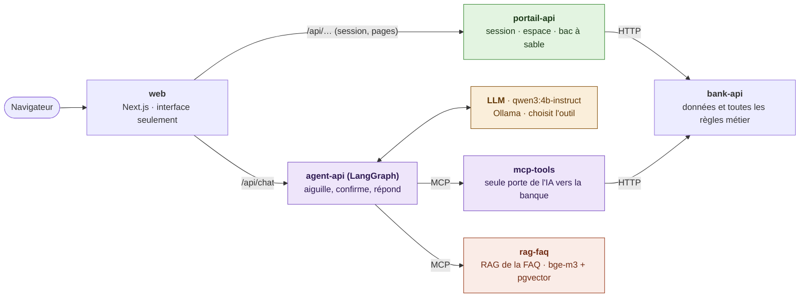

# Architecture de Wakil

> **Données 100 % fictives – projet de démonstration.** Ce document détaille une partie du [README](../README.md).

## Les six services

En vert, les pages et le bac à sable, sans IA. En violet, le chemin de l'IA. En jaune, le LLM, qui **décide** quel outil appeler. En orange, le RAG de la FAQ, qui **cherche**.

| Service | Port | Son rôle | Ce qu'il ne fait jamais |
|---|---|---|---|
| `web` (Next.js) | 3000 | Les pages et le chat. Envoie `/api/chat` à agent-api et le reste de `/api/…` à portail-api | Aucune règle métier, aucun appel à bank-api |
| `portail-api` (FastAPI) | 8003 | Ouvre la session (jeton signé avec la clé privée, dans un cookie HttpOnly) et sert les pages de l'espace bancaire ; plus tard, le bac à sable des visiteurs | Aucune IA : ni LLM, ni agent, ni outil MCP |
| `agent-api` (FastAPI, LangGraph) | 8001 | Wakil : le LLM comprend la demande et choisit l'outil ; LangGraph aiguille vers les outils de la banque ou la FAQ, demande « Wach nconfirmi ? » avant toute opération, et le code écrit la réponse | Ne crée aucune session (il n'a que la clé publique), n'appelle jamais bank-api directement, n'a aucun accès à l'index de la FAQ |
| `mcp-tools` (serveur MCP) | 8002 | Les outils de la banque pour l'IA : retrouve la facture ou le bénéficiaire ; sans la confirmation du client, fait seulement une vérification à blanc | Ne prend jamais le client dans les arguments du LLM (il vient du jeton de session, relayé par agent-api) |
| `rag-faq` (serveur MCP) | 8004 | Le RAG de la FAQ : l'outil `question_faq` retrouve la fiche la plus proche (bge-m3 + pgvector, dans sa propre base) ; l'indexation de `faq.yaml` | Ne rédige rien, ne parle ni à la banque ni au LLM de l'agent, ne reçoit pas l'identité du client |
| `bank-api` (FastAPI, PostgreSQL) | 8000 | Les données fictives et toutes les règles : solde suffisant, plafond, facture déjà payée, compte du bon client ; journal d'audit | Ne connaît ni l'IA, ni le navigateur ; n'accepte que des jetons de 60 secondes signés par mcp-tools ou portail-api |

Trois règles tiennent cette découpe :

- **L'IA n'atteint la banque et la FAQ que par MCP** : agent-api → mcp-tools → bank-api, et agent-api → rag-faq. Chaque outil n'est accepté que de son serveur. Des contrats [import-linter](https://import-linter.readthedocs.io/) (l'équivalent Python d'ArchUnit) le vérifient à chaque `uv run lint-imports` :
  - agent-api ne peut importer aucun client HTTP ;
  - portail-api ne peut importer aucune brique d'IA ;
  - rag-faq ne peut importer ni LangGraph ni client HTTP.
- **La session est créée à un seul endroit** : portail-api signe le jeton (RS256) avec sa clé privée. agent-api le vérifie avec la clé publique, sans pouvoir en fabriquer, puis le relaie au serveur MCP, qui le vérifie à son tour et signe son propre jeton de 60 secondes pour la banque ([ADR 0004](adr/0004-jetons-entre-services.md)).
- **Les règles métier ne sont jamais confiées au LLM** : c'est bank-api qui accepte ou refuse une opération.

Chaque service a sa propre base PostgreSQL et son propre utilisateur, sans droit sur les autres : la banque (`banque_atlas_demo`), les conversations de l'agent (`wakil_agent`) et les vecteurs de la FAQ (`wakil_faq`). Un agent piégé ne peut donc pas modifier la FAQ. Le LLM et le modèle d'embeddings tournent en local avec Ollama. Le pourquoi de cette découpe est expliqué dans [docs/adr/0001-roles-des-services.md](adr/0001-roles-des-services.md).

Deux schémas pour comprendre : [les 6 services, le LLM qui décide et le RAG de la FAQ](schemas/architecture.png), et [le trajet d'une question de FAQ puis d'un paiement, entre le LLM, l'agent, la FAQ, le serveur MCP et la banque](schemas/agent-mcp-sequence.png).

## La FAQ, citée sans rien inventer

Pour une question générale (frais, plafond, carte perdue, sécurité…), Wakil retrouve la fiche de la [FAQ](../data/faq/faq.yaml) la plus proche et **cite son texte tel quel**, avec sa source. Le LLM ne rédige rien : il reconnaît seulement que c'est une question de FAQ, et agent-api appelle l'outil `question_faq` du serveur MCP `rag-faq` avec la phrase du client. Le choix est expliqué dans [docs/adr/0002-faq-reponses-citees.md](adr/0002-faq-reponses-citees.md).

1. **Indexation**, à chaque modification de la FAQ : le modèle d'embeddings `bge-m3` transforme le texte de chaque fiche, et chacune de ses questions types en darija, en un vecteur de 1024 nombres. Ces vecteurs sont rangés avec pgvector dans la base de rag-faq.
2. **À chaque question** : la phrase du client devient un vecteur, et pgvector trouve la fiche la plus proche (similarité cosinus). Sous le seuil de 0,60, Wakil répond qu'il n'a pas trouvé, au lieu de citer un texte qui ne répond pas.

## Les cartes, et le mode sécurité

Dans l'espace « Ma carte », le client bloque ou débloque sa carte, fait opposition (perte ou vol : c'est définitif), puis commande une nouvelle carte. Wakil, lui, peut seulement **bloquer** une carte (« bloqui liya la carte »), toujours après confirmation : réactiver une carte ou faire opposition ne passe jamais par la conversation.

Tant que la carte est bloquée, ou que toutes les cartes sont en opposition, Wakil passe en **mode sécurité** : il ne fait plus rien (ni lecture, ni opération, ni FAQ) et explique comment débloquer la carte dans l'espace. C'est un choix volontaire pour la démonstration : une vraie banque laisse en général le compte utilisable quand seule la carte est bloquée.

